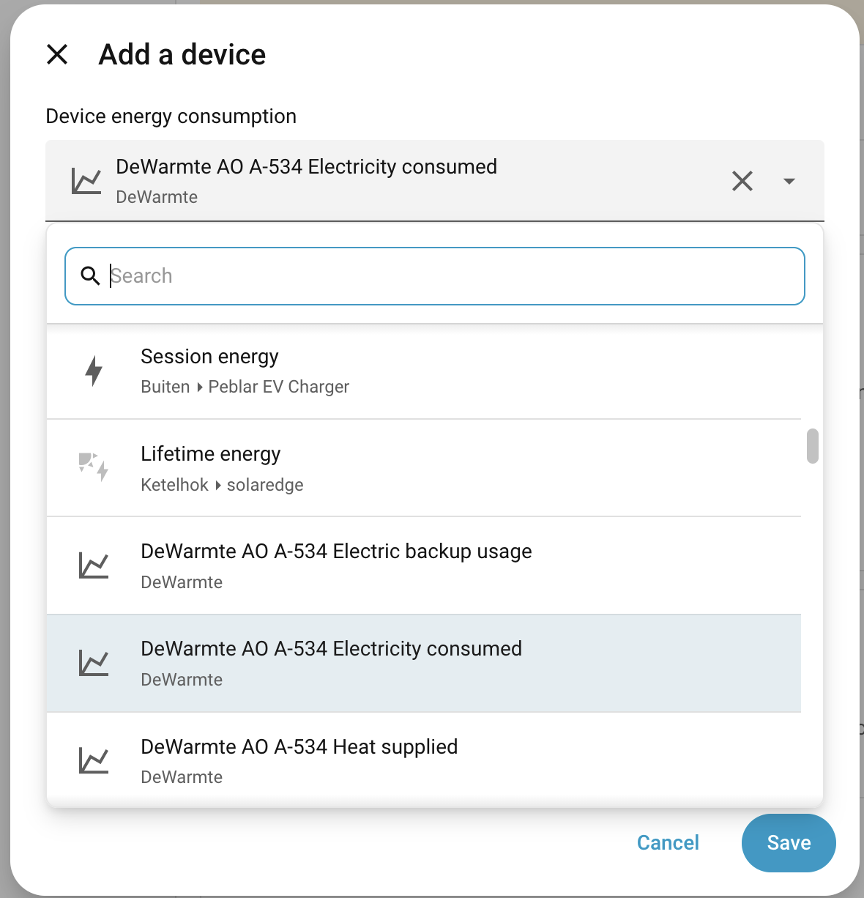

# DeWarmte Integration for Home Assistant (unofficial)

[![GitHub Release][releases-shield]][releases]
[![GitHub Activity][commits-shield]][commits]

This integration lets you monitor and control your DeWarmte systems from Home Assistant. It supports the Pomp AO, Pomp MP, Pomp T and Heatcycle. Every product on your MyDeWarmte account is added as a device; which entities a device gets depends on its type.

This integration is *not* an official DeWarmte integration. Please use [GitHub issues](https://github.com/ronald-willems/dewarmte-homeassistant/issues) for bugs and requests.

## Features

- Sensors for all devices: power (heat input, heat output, electricity consumption), temperatures, fault code and operating state.
- Energy (kWh) sensors and a CoP sensor, usable in the Energy dashboard.
- Import of DeWarmte's own hourly energy history into Home Assistant's long-term statistics, including the years before you installed this integration.
- All settings from the DeWarmte app: heat curve, heating performance, backup heating, sound, cooling (Pomp AO/MP), warm water and smart heating control (Pomp T), legionella protection (Pomp T).
- Forced cooling ("cool now") through two services.
- Update interval, credentials and energy history import can be changed afterwards from the integration's Configure screen.

## Installation

### HACS

1. Install [HACS](https://hacs.xyz/) if you haven't already.
2. Go to HACS, search for *DeWarmte* and click *Download*.
3. Restart Home Assistant.
4. Go to Settings → Devices & services → *Add integration* and search for *DeWarmte*.
5. Fill in the install screen (see [Configuration](#configuration)).

### Manual installation

1. Copy the `custom_components/dewarmte` directory into the `custom_components` directory of your Home Assistant configuration.
2. Restart Home Assistant.
3. Go to Settings → Devices & services → *Add integration* and search for *DeWarmte*.
4. Fill in the install screen (see [Configuration](#configuration)).

## Configuration

The install screen asks for:

- **Email** and **password** of your MyDeWarmte account (the same login as the app and mydewarmte.com).
- **Update interval** in seconds. How often Home Assistant polls DeWarmte; default 60.
- **Import energy history from DeWarmte**. On by default for new installs; see [Energy history import](#energy-history-import).

After installation you can change these under Settings → Devices & services → DeWarmte → *Configure*:

- **Update interval**
- **Credentials**
- **Energy history import**: switch the import on or off, see its status, or delete the imported history.

## Entities

For the full list with descriptions and device applicability, see the [entity reference](docs/ENTITIES.md). In short:

### Sensors (all devices)

- Heat Input, Heat Output and Electricity Consumption (kW)
- Fault Code
- Operating State (not for Heatcycle): off, heating, cooling, defrosting, disinfecting, standby. The same status as in the DeWarmte app.
- Settings State (Pomp AO, MP and T): whether the last settings change was *sent*, *applied* by the pump, or *restored* by DeWarmte. A warning is logged when a change is restored.

### Sensors per device type

- **Pomp AO and MP**: Supply, Outdoor, Actual and Target Temperature, Water Flow, Electric Backup Usage (kW), Gas Boiler, Thermostat, Is On, Is Connected, and for pumps with cooling: Forced Cooling Active, Forced Cooling Setpoint and Forced Cooling End.
- **Pomp T**: Top and Bottom Boiler Temperature, Electric Backup (the electric heater), Is On, Is Connected.
- **Heatcycle**: Top and Bottom Boiler Temperature.

### Energy and CoP

- An energy sensor (kWh) for every power sensor (kW), calculated by Home Assistant from the polled power. These are the sensors to pick under *Individual devices* in the Energy dashboard, unless you use the imported energy history (see below).
- A CoP sensor: heat output energy divided by electricity consumption energy, both since the integration was installed. It is a running average over that whole period, not a live value.

### Settings

All settings that can be adjusted in the DeWarmte app or web app are available as number, select, switch and time entities:

- **Pomp AO and MP**: heat curve (weather compensation or fixed temperature, curve points), heating kind, heating performance mode and backup temperature, backup heating mode, sound mode, compressor power and fan speed, thermostat delay, boost mode. For pumps with cooling: cooling thermostat type, cooling control mode, cooling temperature and cooling duration.
- **Pomp T**: Warm Water Target Temperature (a fixed setpoint, 40–70 °C in steps of 5 °C), Smart Heating Control switch with Smart Control Minimum and Maximum Temperature, and the weekly Legionella Protection Day and Time.

Schedules are not supported from Home Assistant: the warm water schedule of the Pomp T and the cooling schedules of the Pomp AO/MP are managed in the DeWarmte app. Cooling schedules are passed through unchanged when you change another cooling setting.

Smart heating control (Pomp T) requires that you accept its terms in the DeWarmte app first. Without that the entities show default values and changes do not stick.

When DeWarmte rejects a change, the error shown in Home Assistant includes DeWarmte's own reason.

### Services

For a Pomp AO or MP with cooling:

- `dewarmte.start_forced_cooling`: start cooling now for a fixed number of hours at a given setpoint, overriding the other cooling settings until it ends.
- `dewarmte.stop_forced_cooling`: stop a running forced-cooling run.

Both take the DeWarmte device as a parameter and can be used from automations and scripts.

## Energy history import

DeWarmte meters the energy of your heat pump itself and keeps the hourly history from the day it was installed. With the import switched on, the integration copies that history into Home Assistant as long-term statistics named *Heat supplied*, *Electricity consumed* and *Electric backup usage* per device, and adds the new hours every hour.

- **New installs**: switched on by default on the install screen.
- **Existing installs**: stays off after updating. Switch it on under *Configure* → *Energy history import* → *Settings*.
- The first import runs in the background and can take several minutes per device. A notification tells you when it has started and when it has finished; the Configure screen shows how far it has come.
- **Energy dashboard**: under *Individual devices*, use either the imported statistics or the DeWarmte energy sensors for the same heat pump, not both, or the energy is counted twice.

  

  The imported statistics are the entries with the chart icon (*Heat supplied*, *Electricity consumed*, *Electric backup usage*). The DeWarmte energy sensors appear further down the same list, as entity ids ending in `_energy`.
- The imported statistics have no entity, so they cannot feed a Utility Meter helper or an automation. They do work in the Energy dashboard and in statistics cards.
- Hours that DeWarmte has no data for are left empty rather than estimated.
- *Delete imported history* on the Configure screen removes everything the import wrote. Long-term statistics are never purged by Home Assistant, so this is the way back out.

## Troubleshooting

1. Check your credentials under *Configure* → *Credentials*.
2. Check the Home Assistant logs. For more detail, enable debug logging for `custom_components.dewarmte` (Settings → Devices & services → DeWarmte → *Enable debug logging*, or through the `logger` integration). The log then contains the requests and responses, without your password.
3. A setting that jumps back to its old value means DeWarmte restored it; the Settings State sensor shows *Restored* and a warning is logged.
4. [Open an issue](https://github.com/ronald-willems/dewarmte-homeassistant/issues) with the log lines and your device type.

## Development

To contribute to this integration:

1. Fork the repository
2. Create a new branch for your feature
3. Make your changes
4. Submit a pull request

See [AGENTS.md](AGENTS.md) for the repository layout, the local test and deploy loop, and the conventions used in this repository.

## Support this project

This integration is developed in my spare time and is completely free. If you enjoy it, you can [buy me a coffee ☕](https://bunq.me/ronaldwillems). It is never required — a GitHub star is just as welcome!

## License

This project is licensed under the MIT License - see the LICENSE file for details.

[commits-shield]: https://img.shields.io/github/commit-activity/y/ronald-willems/dewarmte-homeassistant.svg
[commits]: https://github.com/ronald-willems/dewarmte-homeassistant/commits/main
[releases-shield]: https://img.shields.io/github/release/ronald-willems/dewarmte-homeassistant.svg
[releases]: https://github.com/ronald-willems/dewarmte-homeassistant/releases
