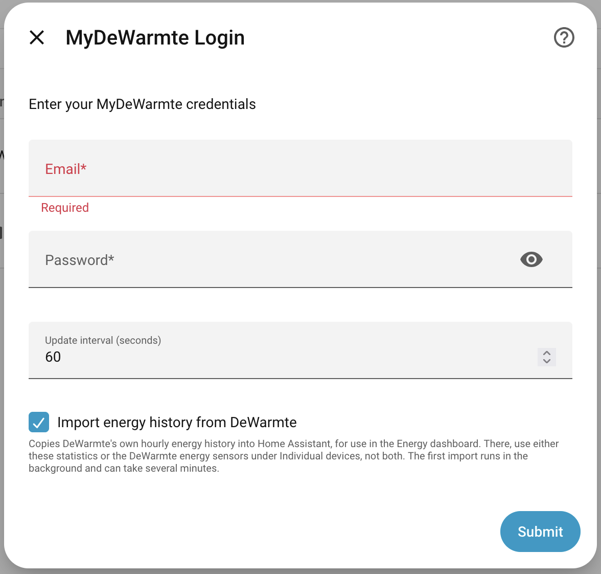
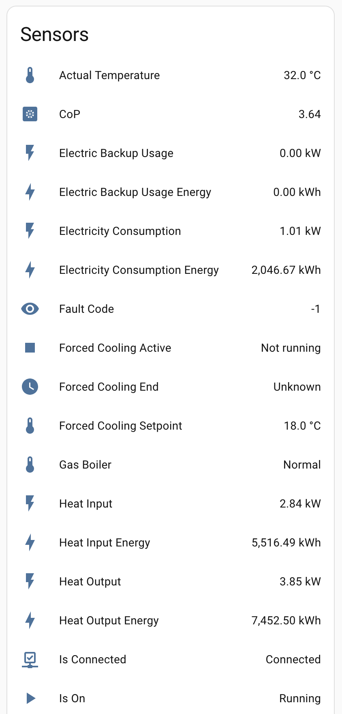
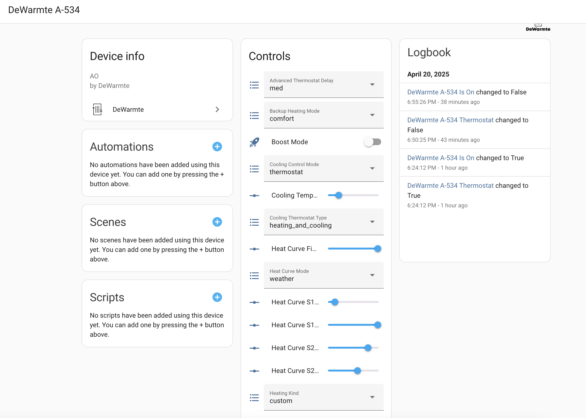
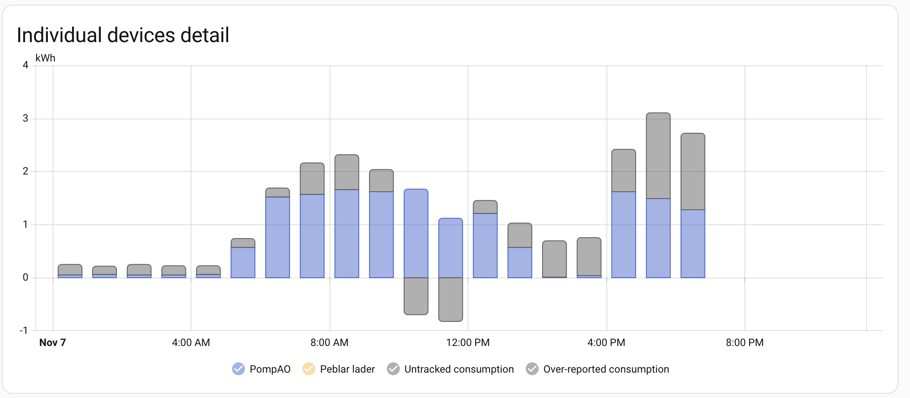
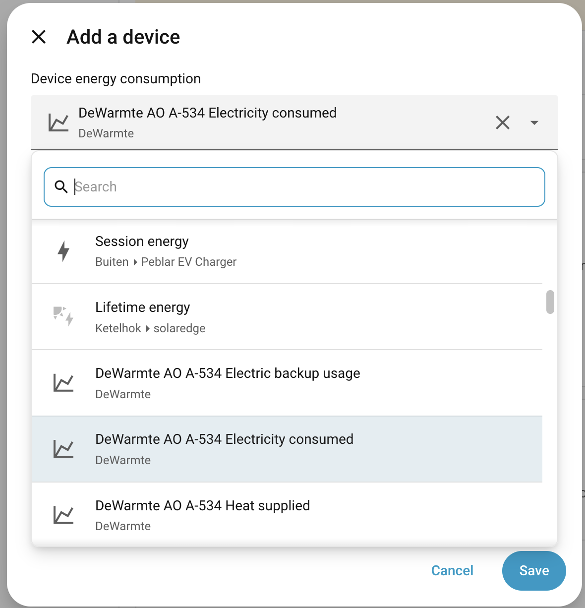

# DeWarmte Integration for Home Assistant

Monitor and control your DeWarmte heat pump from Home Assistant. Supports the Pomp AO, Pomp MP, Pomp T and Heatcycle.

This integration is *not* an official DeWarmte integration.

## Features

- Sensors for power, energy, temperatures, fault code and operating state
- Energy (kWh) and CoP sensors for the Energy dashboard
- Import of DeWarmte's own hourly energy history, including the years before you installed this integration
- All settings from the DeWarmte app: heat curve, heating performance, backup heating, sound, cooling (Pomp AO/MP), warm water, smart heating control and legionella protection (Pomp T)
- Forced cooling ("cool now") services for automations

Full documentation: [README](https://github.com/ronald-willems/dewarmte-homeassistant#readme) and [entity reference](https://github.com/ronald-willems/dewarmte-homeassistant/blob/main/docs/ENTITIES.md).

## Screenshots

### Setup

_Log in with your MyDeWarmte account_

### Sensors

_Live status, energy and CoP of a Pomp AO_

### Settings

_The device page with all settings as controls_

### Energy dashboard

_The heat pump's electricity consumption in the Energy dashboard, from DeWarmte's own hourly history_

_Under Individual devices, pick either the imported statistics (chart icon) or the DeWarmte energy sensors further down the list, not both_

## Support

Having issues? Report them in the [GitHub repository](https://github.com/ronald-willems/dewarmte-homeassistant/issues).

Enjoying the integration? You can [buy me a coffee ☕](https://bunq.me/ronaldwillems) — appreciated but never required!
